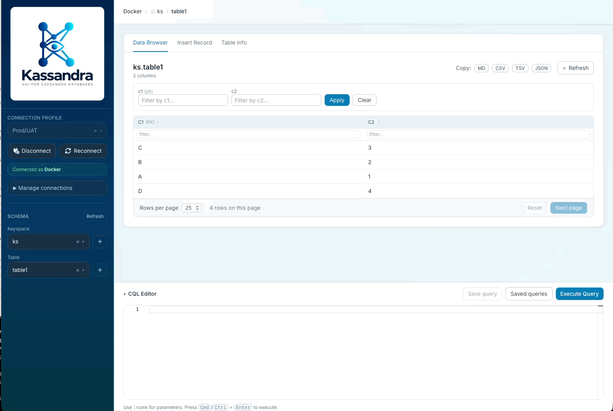
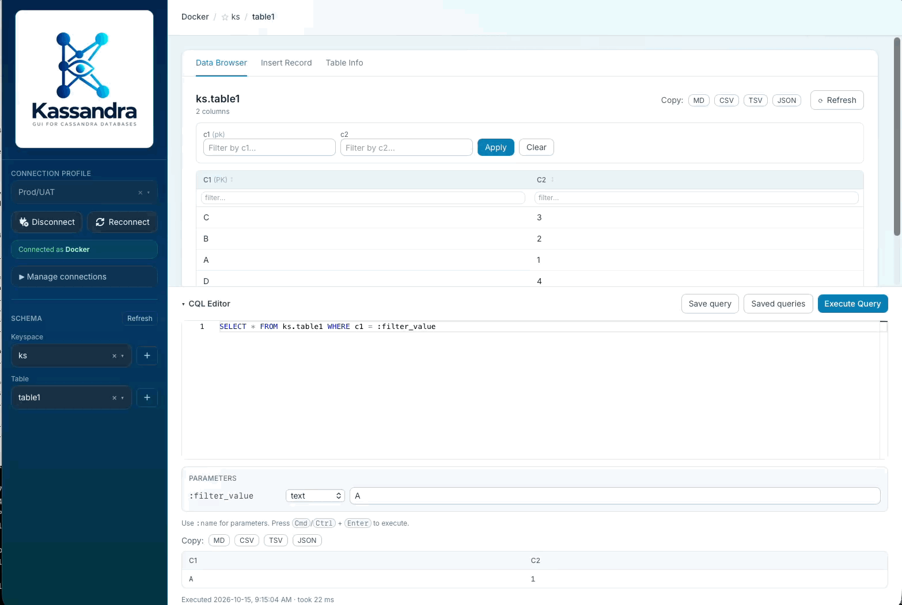
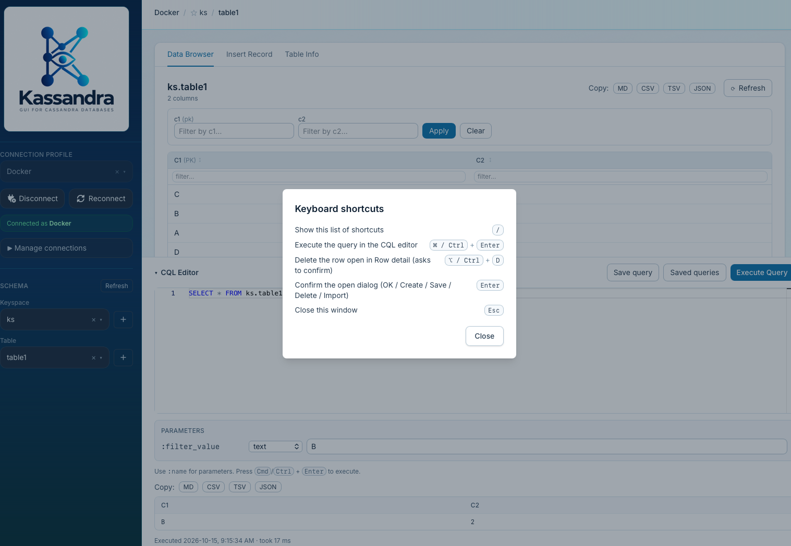

# Kassandra v1.4.0 release notes

## Highlights

- **Saved parametrized queries.** Put named `:param` placeholders in a CQL query and Kassandra shows a **Parameters**
  panel under the editor with a type selector and a value field for each one. Values are bound as typed
  prepared-statement parameters, never spliced into the CQL text.
    - **Save query** stores the query with a name, a description and its parameter types. **Saved queries** lists them
      so you can **Open**, **Edit** or **Delete** one.
    - **Import** and **Export** in the Saved queries dialog share queries as JSON. They are stored in `config.json`
      under `saved_queries`.

  

  

- **Keyboard shortcuts.** Press **/** anywhere outside a text field to open the shortcut list.

  | Shortcut             | Action                                                         |
    |----------------------|----------------------------------------------------------------|
  | `/`                  | Show the list of shortcuts                                     |
  | `⌘`/`Ctrl` + `Enter` | Execute the query in the CQL editor                            |
  | `⌥`/`Ctrl` + `D`     | Delete the row open in Row detail (asks to confirm)            |
  | `Enter`              | Confirm the open dialog (OK / Create / Save / Delete / Import) |
  | `Esc`                | Close the shortcut list                                        |

  

- **Sort and filter in the Data Browser.** Click a column header to sort (ascending, then descending, then off). Each
  column also has a filter box under its header. Both apply only to the rows loaded on the current page and don't query
  the server or change paging.

## Also in this release

- **Copy bar.** The Data Browser and the CQL results table share a **Copy** strip with MD, CSV, TSV and JSON buttons
  that copy the rows to the clipboard.

## Dependencies

| Package       | From   | To     |
|---------------|--------|--------|
| monaco-editor | 0.56.0 | 0.57.0 |

**Full changelog**: [v1.3.0...v1.4.0](https://github.com/irajhedayati/kassandra/compare/v1.3.0...v1.4.0)
