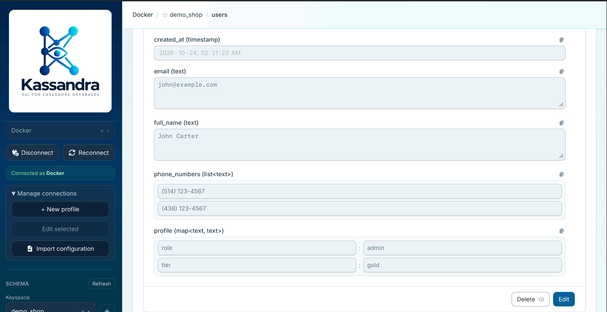
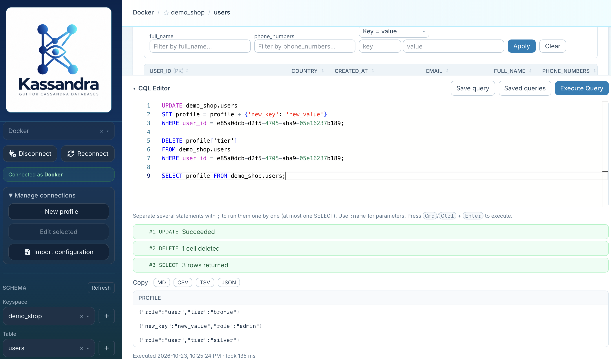

# Kassandra v1.5.0 release notes

## Highlights

- **Edit lists one item at a time.** Lists of primitive CQL types now show an input for each item in the record
  forms. Change values, click **+ Add item**, or remove an item with **×**. Inputs follow the element type, and
  configured enum values appear as dropdowns. Nested collections, sets, and tuples keep the JSON-array editor.
  Click **Generate CQL** to review the changes, then **Execute Query** to apply them.

  

- **Run multiple CQL statements together.** Separate statements with `;` and execute them in order with one click
  or **Cmd/Ctrl+Enter**. A numbered report shows each statement's progress and outcome, including returned rows,
  inserted rows, and deletion counts when available. Execution stops at the first failure and marks the remaining
  statements as skipped; earlier successful statements are not rolled back.
    - Each run supports **at most one SELECT**. Paging runs only that SELECT again.
    - Semicolons inside strings, quoted identifiers, and comments are preserved, and a
      `BEGIN BATCH ... APPLY BATCH` block is treated as one statement.
    - Conditional writes whose `IF` condition is not met are reported as **Not applied**.

  

## Also in this release

- **Application version in the sidebar.** The bottom of the left pane displays the version embedded in the running
  frontend build, sourced automatically from the application's package version.
- **Updated demo walkthrough.** Container and Docker Compose launch instructions, a `phone_numbers` list column,
  and examples for editing lists and executing multiple statements together.

See the [user guide](../index.md) and [demo walkthrough](../demo.md) for instructions.

**Full changelog**: [v1.4.0...v1.5.0](https://github.com/irajhedayati/kassandra/compare/v1.4.0...v1.5.0)
